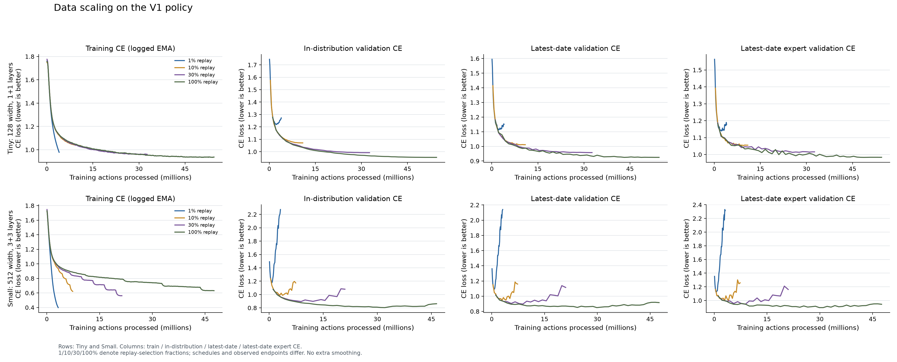
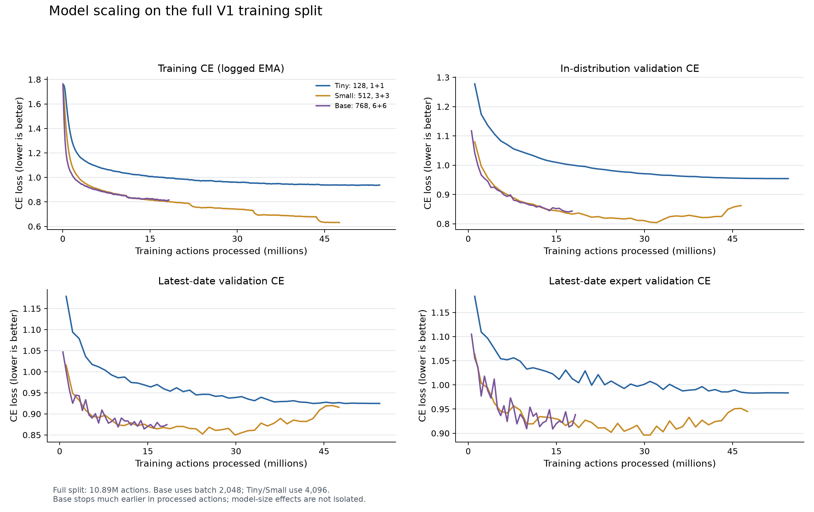
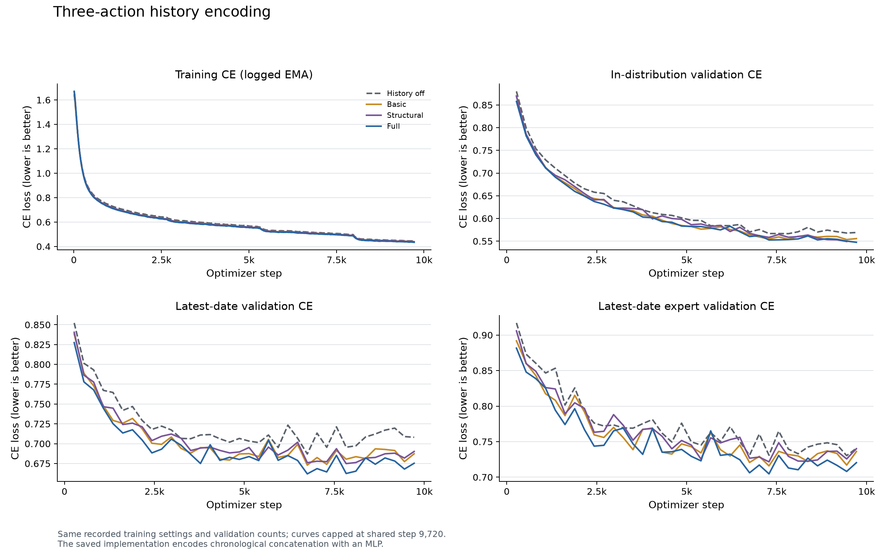
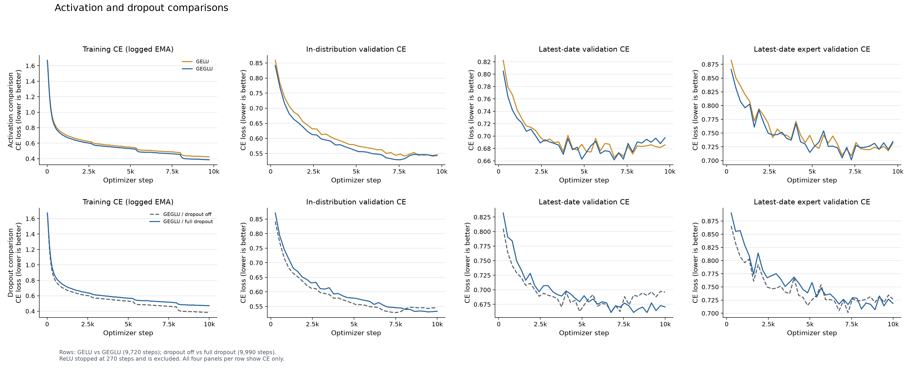
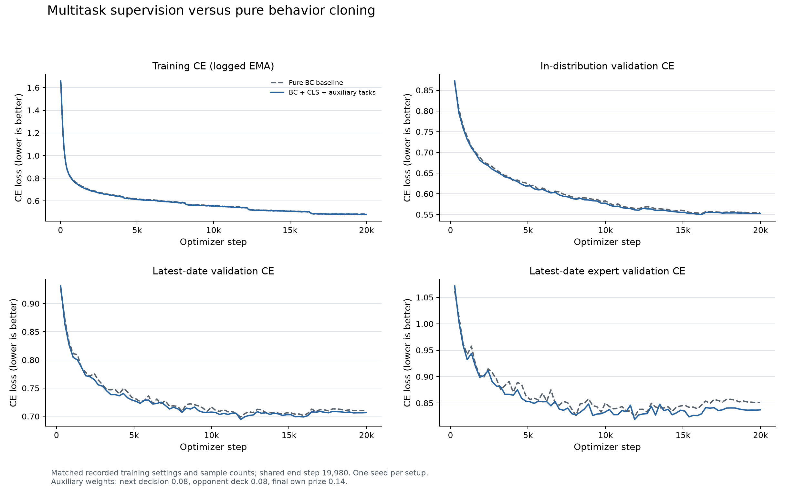
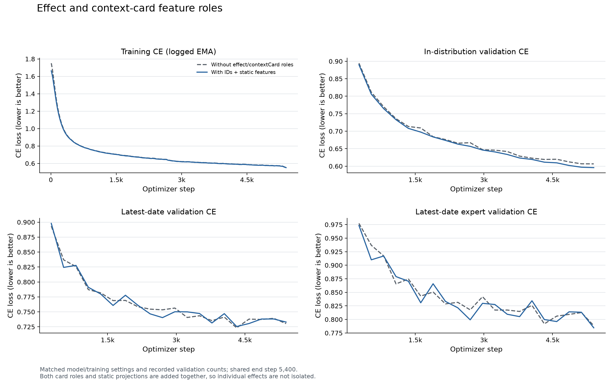

# PTCG 关键实验：四项 CE 指标

本版仅保留数据规模、模型规模、动作历史、激活函数与 dropout、多任务学习、effect/contextCard 六组图。图 6、8、9 原涉及的专项微调、过采样和 expert 条件化实验目前不作为方案证据。

每组图统一展示训练主任务 CE（W&B 已记录的 EMA）、分布内验证 CE、最新日期验证 CE、最新日期高手子集验证 CE。**CE 越低越好。** 验证曲线使用原始记录，没有额外平滑、插值或补齐中断训练。图中的 CE 是动作模仿损失，不能解释为对战胜率。所有结果均为单次配置运行，未进行多随机种子显著性检验。

## 主要观察

- **数据规模：** Small 模型使用 1% Replay 时，训练 CE 迅速降低，三项验证 CE 随后升高；使用全量 Replay 的验证曲线更稳定。不同数据档位的训练 epoch 和调度长度不同，不能仅凭终点拟合 scaling law。
- **模型规模：** 在全量 V1 数据、四项指标共同记录的 step 11,340，Small 相对 Tiny 的训练、分布内、最新日期、最新日期高手 CE 差值依次为 −0.3064、−0.0933、−0.0060、−0.0335。Base 的 batch 和实际训练预算不同，不能据此下模型容量的普遍结论。
- **三步动作历史：** Full 相对无历史的四项 CE 在共同 step 9,720 均更低；最新日期 CE 差值为 −0.0328。
- **激活与正则：** GEGLU 相对 GELU 的训练 CE 更低，但三项验证 CE 略高；完整 dropout 相对关闭 dropout 的训练 CE 更高，三项验证 CE 更低。需要保留这种取舍，不能用单一指标概括胜负。
- **多任务：** 到共同 step 19,980，多任务的四项 CE 都略低于纯 BC；最新日期 CE 差值为 −0.0037。差值较小、只运行单一随机种子，不能宣称稳定增益。
- **effect/contextCard：** 加入两类角色 ID 和静态卡牌投影后，训练及分布内 CE 更低，最新日期 CE 略高，高手子集 CE 略低。此对照无法拆分每种角色的单独作用。

## 图 1：数据规模扩展

[SVG 矢量图](figures/01_data_scaling.svg)

**图注：** Tiny 与 Small 各自展示 1%、10%、30%、100% Replay 选择比例；横轴为累计处理的动作样本数。不同档位的 epoch 和学习率调度长度不同，曲线端点不表示等预算比较。

下表仅给出每个 run 最后记录的最新日期 CE 和实际进度，便于解释图中端点：

| Replay 比例 | Tiny 最新日期 CE | Tiny 已运行/计划步数 | Small 最新日期 CE | Small 已运行/计划步数 |
|---|---:|---:|---:|---:|
| 1% | 1.1506 | 1,008/2,800 | 2.1403 | 810/2,800 |
| 10% | 1.0113 | 2,670/2,670 | 1.1594 | 1,800/2,670 |
| 30% | 0.9575 | 7,970/7,970 | 1.1149 | 5,210/7,970 |
| 100% | 0.9248 | 13,300/13,300 | 0.9156 | 11,610/13,300 |

Small 的 1% run 训练 CE 最终约 0.399，但最新日期 CE 随训练升至约 2.1；全量 run 的训练 CE 约 0.631，最新日期 CE 约 0.9。小训练集的低训练损失不代表较好的留出表现。

## 图 2：模型规模扩展

[SVG 矢量图](figures/02_model_scaling.svg)

**图注：** 固定为完整 V1 训练划分，对比 Tiny（128 维，1+1 层）、Small（512 维，3+3 层）和 Base（768 维，6+6 层）。横轴为累计处理的训练动作样本。

实验：[model_v1_data_full_model_small_pretrained / izjmqifz](https://forge.coreweave.com/wandb/xlz1014361885-tokyo/ptcg_bc/runs/izjmqifz)；对照：[model_v1_data_full_model_tiny_pretrained / 34onyy62](https://forge.coreweave.com/wandb/xlz1014361885-tokyo/ptcg_bc/runs/34onyy62)。四项指标共同记录的最后时点为 **optimizer_step=11,340**。

| 指标 | 实验 | 对照 | 差值（实验−对照） |
|---|---:|---:|---:|
| 训练 CE（日志 EMA） | 0.6316 | 0.9380 | -0.3064 |
| 分布内验证 CE | 0.8620 | 0.9553 | -0.0933 |
| 最新日期验证 CE | 0.9197 | 0.9257 | -0.0060 |
| 最新日期高手子集验证 CE | 0.9513 | 0.9849 | -0.0335 |

Tiny 与 Small 均使用 batch 4,096。Small 在这四项 CE 上均较低，但最新日期差值很小。Base 使用 batch 2,048，且仅处理约 18.2M 个训练动作；不能将它的终点与其他模型直接当作等训练预算对照。

## 图 3：三步动作历史

[SVG 矢量图](figures/03_action_history.svg)

**图注：** 比较无历史、Basic、Structural、Full 四种编码；各曲线截在共同训练进度 9,720 step。Full 在这四项 CE 上优于无历史对照。

实验：[ver_1.4.3_full_12 / hcfee8qy](https://forge.coreweave.com/wandb/xlz1014361885-tokyo/ptcg_bc/runs/hcfee8qy)；对照：[ver_1.4.2_mlp32 / msrhj27e](https://forge.coreweave.com/wandb/xlz1014361885-tokyo/ptcg_bc/runs/msrhj27e)。四项指标共同记录的最后时点为 **optimizer_step=9,720**。

| 指标 | 实验 | 对照 | 差值（实验−对照） |
|---|---:|---:|---:|
| 训练 CE（日志 EMA） | 0.4340 | 0.4428 | -0.0088 |
| 分布内验证 CE | 0.5475 | 0.5690 | -0.0216 |
| 最新日期验证 CE | 0.6753 | 0.7081 | -0.0328 |
| 最新日期高手子集验证 CE | 0.7204 | 0.7408 | -0.0204 |

Full 相对 Basic 的四项 CE 差值分别为 −0.0046、−0.0082、−0.0119、−0.0157。保存的实现将三步动作表示按时序拼接后经 MLP 编码；笔记中提及的 1D CNN 不是该提交实现。

## 图 4：激活函数与 dropout

[SVG 矢量图](figures/04_activation_dropout.svg)

**图注：** 上排比较 GELU 与 GEGLU，截在 9,720 step；下排比较 GEGLU 关闭与启用完整 dropout，截在 9,990 step。每排均按相同顺序展示四项 CE。

### GEGLU 与 GELU

实验：[ver_1.4.5_geglu / dmae120r](https://forge.coreweave.com/wandb/xlz1014361885-tokyo/ptcg_bc/runs/dmae120r)；对照：[ver_1.4.5_gelu / xg77g879](https://forge.coreweave.com/wandb/xlz1014361885-tokyo/ptcg_bc/runs/xg77g879)。四项指标共同记录的最后时点为 **optimizer_step=9,720**。

| 指标 | 实验 | 对照 | 差值（实验−对照） |
|---|---:|---:|---:|
| 训练 CE（日志 EMA） | 0.3857 | 0.4237 | -0.0379 |
| 分布内验证 CE | 0.5451 | 0.5430 | +0.0021 |
| 最新日期验证 CE | 0.6974 | 0.6858 | +0.0116 |
| 最新日期高手子集验证 CE | 0.7345 | 0.7322 | +0.0024 |

GEGLU 训练 CE 优势明显，但三项验证 CE 在这一共同点略高。ReLU run 仅记录 270 step，未纳入成熟期比较。

### Dropout

实验：[ver_1.4.5_geglu_dropout_full / 8gj1gsxn](https://forge.coreweave.com/wandb/xlz1014361885-tokyo/ptcg_bc/runs/8gj1gsxn)；对照：[ver_1.4.5_geglu / dmae120r](https://forge.coreweave.com/wandb/xlz1014361885-tokyo/ptcg_bc/runs/dmae120r)。四项指标共同记录的最后时点为 **optimizer_step=9,990**。

| 指标 | 实验 | 对照 | 差值（实验−对照） |
|---|---:|---:|---:|
| 训练 CE（日志 EMA） | 0.4705 | 0.3826 | +0.0880 |
| 分布内验证 CE | 0.5332 | 0.5447 | -0.0115 |
| 最新日期验证 CE | 0.6707 | 0.6960 | -0.0253 |
| 最新日期高手子集验证 CE | 0.7186 | 0.7267 | -0.0082 |

启用完整 dropout 提高训练 CE，同时降低三项验证 CE。

## 图 5：多任务学习

[SVG 矢量图](figures/05_multitask.svg)

**图注：** 纯 BC 与带 CLS 状态表示及辅助任务的 BC 对比；共同截止 19,980 step。辅助权重分别为 next decision 0.08、opponent deck 0.08、final own prize 0.14。

实验：[ver_1.13.0 / 8o9qul5p](https://forge.coreweave.com/wandb/xlz1014361885-tokyo/ptcg_bc/runs/8o9qul5p)；对照：[ver_1.6.5_d3_33_baseline / dxinbrdj](https://forge.coreweave.com/wandb/xlz1014361885-tokyo/ptcg_bc/runs/dxinbrdj)。四项指标共同记录的最后时点为 **optimizer_step=19,980**。

| 指标 | 实验 | 对照 | 差值（实验−对照） |
|---|---:|---:|---:|
| 训练 CE（日志 EMA） | 0.4799 | 0.4810 | -0.0011 |
| 分布内验证 CE | 0.5526 | 0.5547 | -0.0021 |
| 最新日期验证 CE | 0.7066 | 0.7103 | -0.0037 |
| 最新日期高手子集验证 CE | 0.8371 | 0.8512 | -0.0141 |

记录中的训练 CE 是主动作预测损失的 EMA，并非主任务加辅助任务的总损失。两组记录的训练样本数与训练设置一致；单次运行的细小差值不等于稳健的真实对战收益。

## 图 7：effect/contextCard 特征

[SVG 矢量图](figures/07_effect_context.svg)

**图注：** 比较是否同时加入 effect 与 contextCard 角色 ID 及对应静态卡牌投影；共同截止 5,400 step。

实验：[ver_1.4.0 / 8kju2961](https://forge.coreweave.com/wandb/xlz1014361885-tokyo/ptcg_bc/runs/8kju2961)；对照：[ver_1.3.6_residual_false_mlp2 / no12vhhe](https://forge.coreweave.com/wandb/xlz1014361885-tokyo/ptcg_bc/runs/no12vhhe)。四项指标共同记录的最后时点为 **optimizer_step=5,400**。

| 指标 | 实验 | 对照 | 差值（实验−对照） |
|---|---:|---:|---:|
| 训练 CE（日志 EMA） | 0.5514 | 0.5530 | -0.0015 |
| 分布内验证 CE | 0.5959 | 0.6066 | -0.0107 |
| 最新日期验证 CE | 0.7329 | 0.7303 | +0.0026 |
| 最新日期高手子集验证 CE | 0.7845 | 0.7885 | -0.0040 |

四项 CE 的方向并不一致：分布内略有收益，最新日期略退化，高手子集略有收益。因两类角色和静态投影同时改变，不能独立归因于其中一项。

## 最终方案与证据边界

最终 `submission.ipynb` 加载 `archive (3).zip` 中的 3+3 层模型与 `archive (2).zip` 中的 4+4 层模型，对各自 softmax 后的动作概率取均值，再执行决策。这两个模型使用全量数据训练，架构宽度均为 512；图中的早期 V1 scaling run 不应被误写成最终模型的验证结果。当前没有与这两个最终 checkpoint 对应的相同样本单模型/集成评估，不给集成收益编造数值。

本次读取 W&B 项目索引的 98 个 run；下载了 59 个候选 run 的完整历史，合计 82,706 条记录。主要对照取四项 CE **最后共同记录的 optimizer step**，不挑选各自最佳点。训练曲线使用记录的 EMA，验证曲线使用原始点；重复 step 取最后记录。对于跨版本的实验，记录的样本数及配置相同并不等于已重算数据成员哈希，结论只对应这些实际运行。

- [W&B 项目](https://forge.coreweave.com/wandb/xlz1014361885-tokyo/ptcg_bc)；[比赛思路笔记](https://app.notion.com/p/39f888c4bb6180d1a714f6a930465490)
- [四项 CE 的精确对照数据](../outputs/solution_analysis/reviewed_comparisons.json)；[绘图数据点](../outputs/solution_analysis/chart_data.json)；[历史下载覆盖记录](../outputs/solution_analysis/history_manifest.json)
- [绘图入口脚本](../outputs/solution_analysis/analyze_and_plot.py)；[CE 绘图实现](../outputs/solution_analysis/plot_selected_ce.py)
