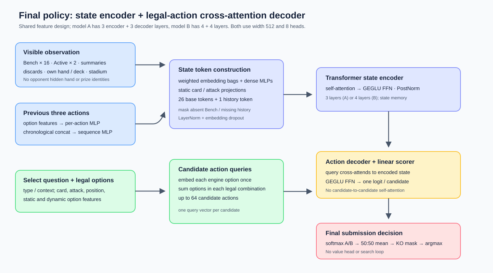

# The Pokémon Company – PTCG AI Battle Challenge Simulation: Transformer Behavior Cloning

**Final rank: 59 / 6,807 teams.** This is my solution to the [Kaggle simulation competition](https://www.kaggle.com/competitions/pokemon-tcg-ai-battle/). The final submission is a two-model Transformer policy ensemble trained on game replays. I used supervised next-action prediction rather than an online reinforcement-learning or search pipeline.

The experiments below report **offline action-prediction cross-entropy (CE)**, not game win rate. They explain the route to the solution, but the plotted holdout runs are not measurements of the final full-data checkpoints. The six figures and their exact W&B run matches are also collected in the [experiment report](docs/solution-experiment-results.md).

---

## Overview

The competition agent receives an observation and a list of legal options, and must select an action. A Pokémon TCG game contains hidden information, many card interactions, varying decks, and decisions whose consequences span several turns. My central bet was that a model trained to predict actions from many replayed games could learn reusable relationships between the state, the current selection question, and candidate answers.

The pipeline is:

1. Extract each decision's observation, legal options, selected action, player, result, deck, and replay identity from dated replay archives.
2. Convert state regions and candidate actions into model-ready features. Keep complete replays together when making holdout sets.
3. Train a Transformer encoder over state tokens and an action decoder over the legal candidates, using behavior cloning.
4. Compare configurations on in-distribution, later-date, expert-subset, and deck/archetype-isolation holdouts.
5. Train the chosen 3+3- and 4+4-layer configurations on the full selected data. At inference, average their action probabilities and select a legal action.

The final notebook is [submission.ipynb](submission.ipynb). Its two local checkpoint archives are `archive (3).zip` (`final_d2_33.pt`) and `archive (2).zip` (`final_d2_44.pt`). See [README.md](README.md) for the repository workflow. The competition-process notes that motivated the experiments are in [Notion](https://app.notion.com/p/39f888c4bb6180d1a714f6a930465490).

---

## Why behavior cloning

### The research question behind the submission

I started with a more ambitious question than “how do I tune one deck for the leaderboard?” A card game exposes an agent to different cards, deck constructions, opposing strategies, and hidden information. I wanted to know whether a sufficiently broad **next-action prediction** task could teach a model reusable card and decision relationships. The analogy in my notes was language-model pretraining: a simple prediction objective can create useful internal representations when the data are varied and the model must resolve context. This was a motivation, not evidence that my policy learned a complete game simulator or that matching replay actions is equivalent to optimal play. In this setting the objective is

$$\mathcal{L}_{BC}=-\mathbb{E}_{(o,C,a^*)\sim D}\log\frac{\exp f_\theta(o,a^*)}{\sum_{a\in C}\exp f_\theta(o,a)},$$

where $o$ is the observable state, $C$ the enumerated legal candidate actions, and $a^*$ the recorded choice. The model learns a conditional policy over **the options the engine actually offered**, rather than a fixed global action vocabulary. It can thus reuse state and card representations across different decision types.

My notes also separated a broad pretraining distribution from the competition's target distribution: a model could learn general mechanics from many decks, then be adapted toward a current strong deck or expert strategy. That suggested dynamic sampling, stronger-player data, and specialized fine-tuning. The recoverable evidence does **not** show that all those adaptations worked; the final method stayed with broad BC training plus two-model inference.

### Why I chose offline imitation first

I initially considered reinforcement learning. My practical calculation started from environment throughput: each new RL trajectory requires game simulation, whereas the replay archive already contains labeled decisions from many completed games. My early estimate of a roughly order-of-magnitude efficiency advantage for a BC-first route was a **planning judgment**, not a controlled benchmark of equally tuned RL and BC systems. The project does not retain an RL-versus-BC timing experiment that could justify reporting “10× faster” for this competition. Under the available time and compute budget, I put effort into replay coverage, representation, and model capacity.

The literature behind that choice deserves precision. [*Kickstarting Deep Reinforcement Learning* (Schmitt et al., 2018)](https://arxiv.org/pdf/1803.03835) is a particularly close match to my recollection: previously trained expert **teacher policies** guide a student through a distillation objective while the student also learns by RL. The teacher influence is reduced as the student improves. In the paper's **multi-teacher DMLab-30 experiment**, the student reached the from-scratch agent's level in **9.58× fewer environment frames** and later exceeded its final performance. Its teachers were queried on the student's observations **during** RL; this is more specific than pretraining only on stored demonstrations and then switching to pure RL. This is neither a generic 10× wall-clock saving nor a measured BC-versus-RL result for PTCG. My notes conflated those concepts. The useful design principle was that expert guidance can give a student an effective starting policy, while later optimization can go beyond imitation. I implemented the offline starting-policy side, not the RL continuation.

Two other game-agent examples frame that decision. [The original AlphaGo paper](https://research.google/pubs/mastering-the-game-of-go-with-deep-neural-networks-and-tree-search/) trained a policy from human expert games and improved it through self-play RL and search. [AlphaStar's description](https://deepmind.google/blog/alphastar-mastering-the-real-time-strategy-game-starcraft-ii) likewise reports supervised initialization from human replays followed by league RL. These are precedents for staged learning, not evidence that this exact sequence is necessary or cost-effective in PTCG. Conversely, [AlphaGo Zero](https://www.nature.com/articles/nature24270) and [AlphaZero](https://arxiv.org/abs/1712.01815) are **not** examples of expert-demonstration initialization; the former explicitly learns without human game data. Finally, [Deep Q-learning from Demonstrations](https://research.google/pubs/deep-q-learning-from-demonstrations/) combines demonstration and temporal-difference losses and continues to use demonstrations after online learning starts. Its findings caution against assuming that simply pretraining a policy and abruptly switching objectives is sufficient. Those papers inspired a possible future BC→RL path; they do not describe the submitted agent.

The training objective is the CE of the demonstrated legal action. It is a useful proxy for learning decisions from strong play, but it has an important limitation: actions that match a replay are not necessarily the only winning actions, and a small number of errors at critical turns can matter more than many easy decisions. I therefore treated offline CE as a way to select experiments, not as a direct measure of battle strength.

### Replay selection and stronger players' losses

The extraction pipeline retains actions from both players, with each player's result recorded. Training selects winner actions and can additionally include loser actions from replays where **both players pass a daily score threshold**. This matters because a strong player can make sound decisions in a game ultimately lost to hidden information or randomness. It also broadens the situations seen during training, including difficult positions that winner-only sampling may underrepresent. It does **not** imply that every move in a strong player's loss is optimal.

The code implements this as configurable loser augmentation over recent eligible dates; the daily cutoff and date count are training choices. A separate expert threshold defines expert validation subsets. These two thresholds have different meanings and should not be conflated. The pipeline details are documented in [data-pipeline.md](docs/data-pipeline.md) and [training-validation.md](docs/training-validation.md).

The reasoning here is about **selection bias** as much as label quality. A winner-only dataset disproportionately samples states reachable on successful trajectories. It can underrepresent how a strong player acts after a bad opening, unfavorable matchup, or unlucky draw. But adding every losing action would import weak play as well. Requiring *both* players in a game to clear the daily score cutoff is an imperfect proxy for the quality of the losing player's decisions, and using recent dates makes that proxy more relevant to a changing player pool. It does not solve confounding by chance or hidden information. In the checked config, loser augmentation is enabled for the newest **25 eligible training dates** using a daily top-player fraction of **6%**; these settings describe the saved configuration, not a controlled ablation proving that every eligible loser action helped.

I considered two further sampling ideas in the notes. First, if a target deck or elite policy differs from the broad archive, change the training mixture rather than assume uniform replay weight is optimal. Second, change that mixture *during* training: early diverse games may teach mechanics, while rare expert examples may be more useful after the representation is mature. This is a curriculum hypothesis, not a property of the final training loop. The oversampling and fine-tuning attempts were too incomplete or confounded to support the quantitative figure set here, and their absence from the final recipe should not erase why I explored them. An early fall in loss under heavy expert oversampling can reflect rapid fitting of a narrow distribution; it does not establish better final play. Similarly, deck fine-tuning can change the model's behavior on both the target and other decks, so it needs a stable game-level evaluation before adoption.

---

## EDA: what the replay archive said before modeling

The EDA was not merely illustrative. It changed which data I trusted, which holdouts I built, and how I interpreted the leaderboard. The source scripts and fixed settings are in [`imitation_learning/eda/`](imitation_learning/eda/) and [`imitation_learning/cfg/`](imitation_learning/cfg/); the figures below are copies of the generated images under `imitation_learning/outputs/`. These are **descriptive analyses of replay snapshots**, not randomized estimates of causal deck strength or evidence about the submitted model's win rate.

### 1. How many distinct games support each deck?

The exact-deck coverage chart counts **unique replays**, in three increasingly selective pools: all raw replays, selected training replays, and expert-qualified training replays. This is a necessary check before trusting a narrow deck-specific CE score. The largest exact Grimmsnarl deck has **63,433 raw / 34,571 training / 3,640 expert-training replays**, whereas the exact Festival Lead deck has **1,570 / 671 / 226**. Those counts are replay counts, not action counts; the companion CSV also records action samples. A highly frequent deck can dominate ordinary training and aggregate validation, while a target deck with only hundreds of selected games yields noisier specialized conclusions. This motivated named top-deck subsets, minimum coverage requirements for isolation splits, and caution about fine-tuning a broad model on a small exact deck.

The companion chart places each **same-archetype deck variant** at its number of changed card slots relative to a reference top deck, with a log-scaled vertical axis for replay counts. It distinguishes exact-deck familiarity (distance zero) from exposure to related builds. The variants form very different patterns: Alakazam has many observed variants across moderate card changes; Mega Froslass and Festival Lead have separated groups of related and substantially altered builds; expert-qualified variants are sparse in many cells. Thus a random replay split can test a new game while still seeing nearly the same deck. I added exact-deck and archetype isolation to ask harder transfer questions, with minimum sample checks to avoid treating a tiny cell as a stable result. A “changed slot” is a multiset card-count difference, not proof that two decks play alike.

### 2. The opponent meta moved over time

The daily trend figure uses the 8.12–8.15 snapshots with **no score filter** and plots each archetype's share of player appearances and observed win rate. Dragapult's share rose from **17.2% to 27.5%**; Marnie Grimmsnarl's fell from **23.0% to 9.5%**; Festival Lead's grew from **10.6% to 16.3%**. Popularity and observed win rate are visibly different quantities: on 8.12 the frequently used Marnie Grimmsnarl group won about **41.3%**, while the less common Festival Lead group won about **56.2%** in this replay sample. These are conditional replay-sample rates, affected by opponent mix and player strength. The shifting usage made the latest-date holdout substantively useful: it checks a policy against a later mix of states rather than only new replays from the same period.

The Sankey narrows to replays whose **minimum player score is at least 1,060**. Its colored blocks show each day's archetype use in that filtered pool; ribbons connect the **modal archetype of the same team** on successive dates, rather than tracking individual matches or card substitutions. In the plotted high-score sample, Dragapult rises from **29.0% on 8.12 to 33.9% on 8.15**. The figure supports the idea that the high-score opponent mix can differ from the full replay population and that teams sometimes switch decks. It does **not** demonstrate that high-score behavior predicts the broader population or that copying one switch would improve our ranking. It reinforced my decision to keep expert and time-based validation slices separate.

The matchup matrix uses non-mirror replays with **minimum player score at least 1,000** over the same dates. Each cell is the row archetype's observed win rate against the column archetype, with the matchup count shown. For example, Festival Lead won **71% of 451** observed games against Marnie Grimmsnarl, but **40% of 502** against Alakazam and **46% of 980** against Dragapult. Those contrasts explain why I separated **policy strength, submitted deck choice, opponent distribution, and meta adaptation** in my notes. A single aggregate win rate can change as the matchup mix changes even if the agent itself does not. The observational matrix is not a counterfactual deck-selection experiment; player strength, dates, and strategy versions differ between cells.

### 3. Did replay timing make search unattractive?

The replay-timing script aggregates startup time and mean subsequent action time per team, uses log-scaled axes, and fits four K-means clusters on log-transformed times for **all teams** before assigning the score-filtered subset. In the saved analysis, the global cluster centers range from roughly **0.54 or 10.4 seconds startup** and **0.10–0.14 or 2.25 seconds per subsequent action**; only **13 teams** pass `min_score >= 1100`, and none belongs to the slow-action/fast-start global cluster. My competition-time interpretation was that some strong entrants might be using relatively light inference, so I lowered the priority of a heavy search implementation and tested an ensemble instead. That is only an **indirect resource clue**. Replay timing includes runtime, implementation, hardware, loading, and game-state effects; it cannot reveal whether another team used search or how many nodes it explored.

The EDA therefore led to four concrete modeling choices: use broad replay coverage; validate by whole replay and by later date; examine deck/archetype transfer separately; and keep the submitted inference path simple enough to fit the competition setting. Only the first three have direct offline metrics in this repository. The timing analysis informed prioritization, not a measured ablation of search.

---

## Representation and policy model

The diagram follows the saved [`PTCGTransformer.forward`](imitation_learning/model/network.py) data flow and the final [`submission.ipynb`](submission.ipynb). It is worth explaining why I represented the game this way, because a flat vector of every available number would have hidden the structure that mattered to my original idea.

### From V1 state tokens to V2 action-aware features

The first state design in my notes had **24 tokens**: eight Bench positions for each side, two Active Pokémon, two player summaries, own hand, own deck, Stadium, and global information. Each region accumulated learned categorical embeddings and value-weighted numeric embeddings. This was a way to give the Transformer persistent, interpretable entities. It also imposed a useful inductive bias: an Active Pokémon can attend to its energy and damage context, while player summaries can exchange information with the board. The V1 layout was a development step, not the final feature schema; the later model uses **26 base tokens** with separate discard regions and richer summaries. The comparison plots for early Tiny/Small/Base scale trials were produced with V1, which is why their absolute CE is not a final-checkpoint metric.

In V2 I treated each decision as a **question with candidate answers**. The engine's `select` context identifies what kind of choice is being requested; an option carries its type, candidate/target card IDs, attack ID, area and relation, numeric positions, and available static and dynamic card/attack features. This matters in a card game because the same card identity can mean different things when it is a source, target, effect, or context card, and because the legal set changes at every decision. The implementation sums learned and projected feature channels into a 512-dimensional option vector, then applies configured region/option MLPs. Candidate combinations are explicitly enumerated and formed by summing their constituent option vectors. When no option is selected, a learned no-action vector is used. The policy scores at most 64 enumerated legal combinations.

The numeric position fields are also a possible shortcut: replay-generating agents may systematically choose the first of equivalent options. My notes hypothesized that relative position could raise imitation accuracy without changing game strength. I did not establish a controlled game-level test of that hypothesis, so the feature remains an implementation detail rather than a claimed performance mechanism. Likewise, the effect/context-card experiment later in this write-up gave mixed validation signals; having access to more observable information did not guarantee better transfer to a new card family.

### Why an encoder and a candidate-query decoder?

The encoder self-attends over the visible game entities. The decoder starts from one query per legal candidate action and **cross-attends to the same encoded state at each decoder layer**. There is deliberately **no self-attention among candidate actions**. A candidate's score can depend on the entire visible board, while the score for one candidate does not depend on which other candidates happen to be placed beside it in the decoder tensor. The last linear layer returns one logit per action. During BC training, cross-entropy compares these logits with the demonstrated action; during inference, invalid enumerations are masked and the surviving probabilities are compared.

This design answers a specific representation problem. A fixed action-class classifier would need to encode every possible card combination and context in one global output space. Scoring the currently legal options lets the model transfer a learned interaction such as “this target, in this state, makes this option appropriate” across many specific decision menus. The argument is architectural; there is no ablation here proving that the candidate-query decoder is superior to every simpler baseline.

### Carrying local decision history

The present observation does not always expose the intent behind a sequence of choices. In my notes I described short action chains as “combos”: a card selection may only make sense in relation to the immediately preceding selection. The saved model encodes up to three previous actions with independent history embeddings, sums option rows within each historical action, applies a per-action MLP, concatenates the three vectors **in chronological order**, and maps them through a sequence MLP to a single 27th encoder token. `basic`, `structural`, and `full` history modes include progressively richer fields. The final model uses `full`, including card, attack, static, and dynamic history features, while excluding the five option-position numerics from the history representation. My notes called the idea a 1D CNN, but the actual experiment and final submission use concatenation plus MLP. The history ablation below supports retaining this context; it does not identify which individual historical field caused the gain.

### Submitted checkpoint settings

The full field definitions, cache compatibility rules, and configurable projection depths are documented in [model.md](docs/model.md). The diagram depicts the submitted configuration, not every architectural switch that the code supports.

Both submitted models use an encoder-decoder Transformer with 8 attention heads, FFN width 2,048, PostNorm, GEGLU FFNs, and dropout probability 0.1 with the configured dropout switches enabled. Their common input representation and policy head are the same; the layer count differs:

| Submitted checkpoint | Encoder + decoder layers | Width | Trainable parameters |
|---|---:|---:|---:|
| `final_d2_33.pt` | 3 + 3 | 512 | 49,329,665 |
| `final_d2_44.pt` | 4 + 4 | 512 | 57,735,681 |

These specifications were checked against the checkpoint configurations and the model classes embedded in [submission.ipynb](submission.ipynb). The checkpoints contain FP16 tensors; the notebook instantiates FP32 models and loads the weights into them for inference. There is no value head in the submitted policy.

---

## Validation design

Randomly splitting individual decisions would place highly related states from the same game on both sides of the split. The training pipeline therefore assigns **whole replays** to a split. It first removes selected deck/archetype isolation replays, then reserves the latest date, then deterministically partitions older remaining replays into training and in-distribution validation. The selector also supports exact-deck and top-deck-archetype isolation groups. Validation uses winner actions; the training pool can include qualified loser actions.

This evaluation design grew in layers rather than from one headline number. A replay-level random holdout asks whether the model can imitate actions in a new game from the familiar time and deck mix. A latest-date holdout asks whether it can handle a later population; the EDA shows that this population can shift quickly. A daily high-score subset asks whether the policy tracks stronger observed players, but it is still judged by **their chosen actions**, not by the value of counterfactual alternatives. Exact-deck isolation tests a new 60-card combination whose components may be familiar; archetype isolation makes the distribution shift harder by withholding a core deck family. Top-deck-archetype isolation withholds related variants so that matching a reference list is not mistaken for transfer to its family. Where possible, the selector audits replay count and card coverage after the isolation groups are combined.

These splits answer different questions, and none alone gives an unbiased estimate of submission win rate. The latest-date set may also change in player quality, deck composition, and option frequencies at the same time. Isolation groups can be small and can overlap each other, even though their **union** is excluded from training. The saved `expert_validation_ratio` is **0.05**, defining a daily high-score cutoff across participants; a replay enters the expert group if either participant clears it. That is not identical to taking the top 5% of validation actions, and it is distinct from the 6% loser-augmentation threshold that requires both players to qualify. This distinction is important when reading `latest expert CE` in the figures.

The four CE series shown in this write-up are:

| Series | Meaning |
|---|---|
| Training CE | EMA of the main action-prediction loss, as logged during training |
| In-distribution CE | New replays held out from the older, non-isolated dates |
| Latest-date CE | Replays from the latest date excluded from holdout training |
| Latest-date expert CE | Expert subset of that latest-date validation group |

Lower CE is better. The logged training EMA is not the total main-plus-auxiliary loss in the multitask experiment. I also monitored action Top-k accuracy and isolation groups, but the figures here deliberately focus on these four CE measures. None is a measured game win rate or Elo. Full-data final training does not preserve the same independent holdouts; evaluating its checkpoint on reconstructed holdouts it may have seen would not be a valid generalization estimate.

---

## Experiments that shaped the solution

The comparisons use W&B history rather than run names alone. For each paired table, I selected the **last optimizer step at which both runs recorded all four CE metrics**. A positive delta means the experimental variant had higher, worse CE. Runs are single configurations without repeated seeds; several early scale runs ended before their planned step count. The raw curves, exact values, and run links are available in the [experiment report](docs/solution-experiment-results.md).

| Variant − control | Shared step | Train CE Δ | In-distribution CE Δ | Latest-date CE Δ | Latest expert CE Δ |
|---|---:|---:|---:|---:|---:|
| Small − Tiny, full V1 split | 11,340 | −0.3064 | −0.0933 | −0.0060 | −0.0335 |
| Full history − no history | 9,720 | −0.0088 | −0.0216 | −0.0328 | −0.0204 |
| GEGLU − GELU | 9,720 | −0.0379 | +0.0021 | +0.0116 | +0.0024 |
| Full dropout − dropout off | 9,990 | +0.0880 | −0.0115 | −0.0253 | −0.0082 |
| Multitask − pure BC | 19,980 | −0.0011 | −0.0021 | −0.0037 | −0.0141 |
| effect/contextCard roles − no roles | 5,400 | −0.0015 | −0.0107 | +0.0026 | −0.0040 |

The rows are **separate experiments at different development stages**; their CE levels and deltas must not be ranked against each other as if they shared one training set and architecture. The table is a compact index to the matched run pairs, not a factorial ablation of the final submission.

### 1. Data coverage mattered more than fitting a small replay subset

The plan to vary both replay fraction and Transformer capacity came from my broader question about whether action prediction is a **scalable** way to learn the game. [GPT's generative pretraining paper](https://cdn.openai.com/research-covers/language-unsupervised/language_understanding_paper.pdf?file=language_understanding_paper.pdf) was an analogy for learning a useful representation through prediction; [neural-language-model scaling laws](https://arxiv.org/abs/2001.08361) suggested looking at data, model size, and compute together. Neither paper supplies a scaling law for this simulator. I used their experimental questions, then checked what the PTCG runs actually showed.

I began with Tiny (128 width, 1+1 layers) and Small (512 width, 3+3 layers) V1 policies, using 1%, 10%, 30%, or 100% replay-selection fractions. The percentages describe replay selection, not exactly the same percentage of individual actions. Across fractions, epoch counts and learning-rate schedules differed, so the terminal values are descriptive rather than a clean scaling-law experiment.

The most revealing run is the Small model trained on 1% of replays. Its logged training CE reached **0.3985**, while latest-date CE rose to **2.1403** by the observed endpoint. With the full replay split, the Small model's terminal training CE was **0.6312** and latest-date CE **0.9156**. The smaller pool made the training objective easier to fit, but its holdout behavior became much worse. That directly corrected my early intuition that a lower training loss alone would always signal a better policy. The [1% run](https://forge.coreweave.com/wandb/xlz1014361885-tokyo/ptcg_bc/runs/f1ecq0x8) stopped at 810 of 2,800 planned steps; the [full-split run](https://forge.coreweave.com/wandb/xlz1014361885-tokyo/ptcg_bc/runs/izjmqifz) stopped at 11,610 of 13,300, so I do not compare them as equal-compute endpoints.

### 2. Increasing capacity helped the trained V1 comparison, with limits

On the full V1 split, Small had lower CE than Tiny at the last common four-metric evaluation, **step 11,340**: training −0.3064, in-distribution −0.0933, latest-date −0.0060, and latest-date expert −0.0335. Tiny and Small both used batch size 4,096. This supported testing a larger policy, while the small latest-date CE difference cautioned against treating capacity as an unconditional gain.

The Base run used a different batch size (2,048) and ended after fewer processed actions. Its endpoint is informative about that run, but it cannot isolate the effect of scaling width and depth. The final models have the later V2 feature layout and should not be presented as direct outcomes of these early V1 curves.

### 3. Recent action history carried useful decision context

At step 9,720, the **full three-action history** variant had lower CE than history-off: training −0.0088, in-distribution −0.0216, latest-date −0.0328, and latest-date expert −0.0204. Relative to the Basic history variant, the same four differences were −0.0046, −0.0082, −0.0119, and −0.0157. The comparison supports including recent decisions when scoring the current choice; it does not prove which individual historical field is responsible.

### 4. Activation and dropout involved a training–validation trade-off

I tested GEGLU because [*GLU Variants Improve Transformer*](https://arxiv.org/abs/2002.05202) reports improvements from gated Transformer feed-forward blocks in its own setting. That paper was a reason to try the activation, not a reason to declare it superior here before looking at holdouts.

At the shared step 9,720, GEGLU lowered training CE by **0.0379** relative to GELU, but its in-distribution, latest-date, and latest-date expert CE were higher by **0.0021**, **0.0116**, and **0.0024**. I therefore cannot claim that GEGLU won on every validation metric. The ReLU run lasted only 270 optimizer steps and is not an equally trained third comparison.

In the separate GEGLU dropout comparison at step 9,990, full dropout raised training CE by **0.0880** but lowered in-distribution, latest-date, and latest-date expert CE by **0.0115**, **0.0253**, and **0.0082**. This was a clearer regularization signal. The final checkpoint configuration uses GEGLU with dropout; its selection reflects the broader development process and submitted setup, not a claim that the GEGLU-only CE ablation unanimously favored it.

### 5. Auxiliary tasks did not establish a decisive advantage

The motivation was about **how much information the training objective asks the network to use**. A replay contains more than the chosen action: the next decision type, opponent deck, and later outcome are related to state understanding. If the action label can often be predicted from a shallow shortcut, ordinary BC may not force the encoder to represent those other relationships. [ExT5](https://arxiv.org/abs/2111.10952) was one of the multi-task references in my reading list, but its language-task results do not predict a benefit for these game labels. I explored multitask supervision to encourage a richer state representation without collecting new raw games.

My notes considered next Select Type/Context, opponent deck, opponent strength, and prize-related signals. They also raised a useful optimization question: an auxiliary weight scales its gradient, while gradient norm and cosine with the main-task gradient determine whether the shared encoder receives reinforcing or conflicting updates. A fixed auxiliary weight might help early representation learning but distract the policy late; reducing the weight over time was an untested follow-up. The actual logged run used a CLS representation and auxiliary targets for the next decision, opponent deck, and final own prize count, with weights **0.08, 0.08, and 0.14**. This is narrower than the full list of ideas in my competition notes; for example, an opponent-strength task was discussed but is not a confirmed head in this matched run. “Final own prize count” is also not the same label as the originally proposed *prize-count difference*.

Compared with matched pure BC at step 19,980, the multitask variant's training, in-distribution, latest-date, and latest-date expert CE differences were **−0.0011, −0.0021, −0.0037, and −0.0141**. These are small single-run differences. The training curves suggest a modest early or middle-stage benefit whose margin narrows later; they do not support my original shorthand that the main-task training CE had clearly become worse at the end. Multitask learning was an informative experiment, **not a component of the two submitted checkpoints**.

### 6. More card identity features were not a uniform improvement

Adding both effect and context-card role IDs plus static-card projections yielded a mixed result at step 5,400. Relative to the matched variant without them, training CE changed by **−0.0015**, in-distribution CE by **−0.0107**, latest-date CE by **+0.0026**, and latest-date expert CE by **−0.0040**. This is not a clean argument that the extra fields either help or hurt every distribution. Because several inputs changed together, the comparison also cannot assign the effect to either card role alone.

My notes raised a possible mechanism: extra card IDs could encourage memorization of card identity rather than transferable card relationships. That remains a **hypothesis**. The current four-CE comparison does not demonstrate it, and the stronger archetype-isolation observation discussed in the notes needs its own explicitly matched analysis before being used as a quantitative claim here.

---

## Decisions and ideas that did not become the final method

### Specialized adaptation was harder than the pretraining analogy suggested

My initial mental model was “learn general PTCG first, then specialize to the strongest deck or strongest demonstrators.” This sounds like a natural continuation of language-model pretraining, but the target here is an interactive policy. Fine-tuning changes the distribution of decisions the model makes, so an offline action metric on the narrow deck can improve while match outcomes or off-deck behavior worsen. In my notes, deck-specific fine-tuning degraded the observed validation groups, including the target group. I cannot give a clean numeric conclusion from that attempt because its controls and training budget do not meet the standard used for the six figures. I therefore did not carry specialized fine-tuning, high expert oversampling, or explicit expert-identity conditioning into the final submission.

That failed direction still informed the final choice: use the **full selected replay pool** for the two submitted models, preserve broad coverage, and avoid presenting the target-deck distribution as if it were the whole game. It also sharpened an open question: is the obstacle sample scarcity, an unstable fine-tuning schedule, conflicting deck strategies, a missing observation feature, or simply CE's poor alignment with win rate? The current repository cannot separate those explanations. A better follow-up would use matched total updates, a fixed target-deck holdout, at least one non-target holdout, repeated seeds, and paired game evaluations.

### A good agent is only one term in a changing competition environment

The deck-trend and matchup EDA led me to think of leaderboard performance as an interaction among four quantities: **agent decisions, submitted deck, encountered opponent distribution, and adaptation to that distribution**. This is a conceptual decomposition, not an additive formula. For an opponent mixture $p_t(j)$ at time $t$, even a fixed policy/deck pair $(\pi,d)$ has a mixture-dependent expected win rate,

$$W_t(\pi,d)=\sum_j p_t(j)\,P(\text{win}\mid\pi,d,j).$$

The matchup matrix makes the dependence on $j$ concrete. It also explains why latest-date CE and exact-deck CE answer different questions from actual battle performance. I considered whether high-score teams' deck choices might be an early signal of a later meta shift, and whether a counter-meta deck could help. The available four-day descriptive figures are not enough to validate such a forecasting rule. The final notebook fixes one **Festival Lead** deck; it does not implement online deck switching.

My notes also proposed a rating-path hypothesis: early random outcomes might put an agent into a rating band with a different opponent/deck mix, which could affect later scores. That would require verification of the competition's matchmaking and rating rules plus repeated, controlled submissions or match logs. I did not use it to explain the final rank or to claim the same agent would score differently solely from initial luck.

### The missing experiment was a game-level evaluation loop

I built increasingly careful offline validation, but I did not close the loop from action CE to games won. A stable opponent pool should include different decks, strengths, and policy families; each comparison should use paired seeds or mirrored sides where the simulator permits, enough repeated games for uncertainty intervals, and replay review of pivotal mistakes. In particular, aggregate Top-1 accuracy can reward predictable forced or nearly equivalent choices while underweighting a small number of decisive turns. A future analysis would stratify errors by game phase, option type, deck, matchup, and estimated consequence. It would also test whether history and representation gains persist outside the demonstration distribution.

Only after establishing such a loop would I revisit the literature-inspired BC→RL transition: initialize from the broad replay policy, measure the cost of self-play and opponents, retain an expert anchor or distillation term if helpful, and evaluate the resulting policy against the same fixed opponent pool. The literature suggests a possible route; this competition's recovered experiments support the **BC starting point**, not the unrun RL stage.

---

## Final training and inference

After development on holdout runs, I trained the final 3+3- and 4+4-layer policies with the project's full-data training mode. In that mode all cached dates are eligible for training selection, and training-time validation is skipped; winner filtering, eligible loser augmentation, and replay-selection settings still apply. The submitted checkpoints use the same main model configuration apart from Transformer depth. I do not infer an unseen-set score from their full-data training logs.

The [submission notebook](submission.ipynb) loads both checkpoints, reconstructs each architecture from its saved config, and scores the same enumerated legal actions. It applies a softmax to each model's FP32 logits, **averages the two probability vectors equally**, applies its enabled damage-counter KO eligibility mask, and takes the highest-scoring remaining action. The agent retains a three-action history between decisions and supplies a fixed 60-card **Festival Lead** deck. The notebook packages `main.py`, the deck, model manifest, both models, and the competition `cg` package into `submission.tar.gz`. There is no search loop in the submitted agent.

My notes record an earlier offline observation that ensembling helped across several validation sets. I could not recover a like-for-like evaluation of **these exact two final checkpoints** against their individual models, so I report the implemented ensemble without assigning it a numerical gain. Likewise, the project does not provide an independently verified Elo or battle win-rate ablation for the architectural changes above.

---

## Closing assessment

The recovered evidence supports a narrower, more useful story than “a bigger Transformer always wins.” Broad replay coverage prevented an apparent training-loss success from becoming severe latest-date overfitting. A three-action history token improved all four matched CE measures. Dropout traded harder training fit for better holdout CE. Capacity, activation, extra card-role features, and auxiliary tasks had either uneven, small, or confounded comparisons. The final ensemble was the implemented solution, but its exact game-level gain over either constituent model remains unmeasured here.

The most important change in my thinking was to separate **the objective I optimized, the holdouts I used to select models, and the match outcomes I actually cared about**. The broad action-prediction objective was chosen because it might force useful transfer across decks and card interactions, much as a broad predictive pretraining objective can teach reusable representations. The results show meaningful offline learning, but they do not prove general strategic understanding. My next research iteration would begin with the missing game-level evaluation loop, then test whether the model's broad representation can be improved by better replay mixtures or a carefully measured RL continuation.

---

## Reproducibility and sources

- [Competition page](https://www.kaggle.com/competitions/pokemon-tcg-ai-battle/) and [my competition notes](https://app.notion.com/p/39f888c4bb6180d1a714f6a930465490).
- [Experiment figures, CE tables, and W&B run links](docs/solution-experiment-results.md); [figure index](docs/figures/README.md); [W&B project](https://forge.coreweave.com/wandb/xlz1014361885-tokyo/ptcg_bc).
- [Replay extraction and cache construction](docs/data-pipeline.md), [training and validation](docs/training-validation.md), [model architecture](docs/model.md), and [submission workflow](docs/submission.md).
- The comparison tables use the last **common** four-metric optimizer step for each pair, not each run's best point. Training CE is the recorded EMA; validation CE uses raw logged values. There is one run per configuration in these comparisons, no uncertainty interval, and no claim that a small CE delta is statistically significant.

The local W&B export used for this analysis contains 98 run records. Full histories were recovered for 59 candidate runs (82,706 logged rows). The archived [comparison values](outputs/solution_analysis/reviewed_comparisons.json), [plotted points](outputs/solution_analysis/chart_data.json), and [plotting script](outputs/solution_analysis/analyze_and_plot.py) make the charts inspectable when those local analysis outputs are available.
